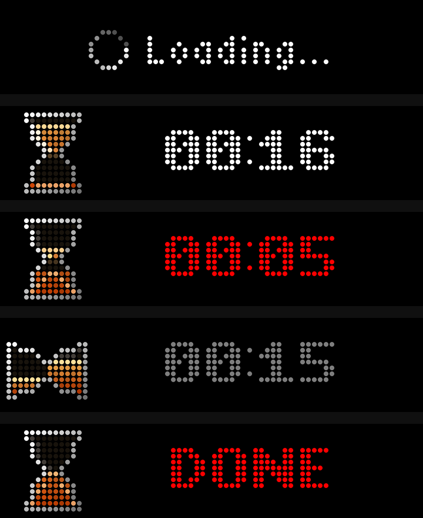
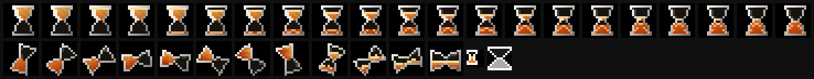

# Design Notes

Why the timer works the way it does: the device model it lives in, the choices
behind the countdown, and how the artwork is made. For the full platform
contract — every API and its behaviour, verified against the firmware — see
`.agents/skills/project-busy-app/`; this document is the human-readable
summary and the reasons behind the app's decisions.

## The device

The BUSY Bar runs apps on-device in a small JavaScript runner. The script is
evaluated from top to bottom and does everything through the device's HTTP
API: it draws elements to the two displays, plays sounds, reads and writes its
settings, and subscribes to the three physical controls. There is no phone or
server component, so the timer keeps working with no network around.

A few device realities shaped the code:

- **Keep the script small.** The launcher shows its own "Loading…" screen
  while the script is parsed and linked, so a big bundle is visibly slow to
  start. The app emits display elements directly and uses plain `fetch`
  instead of a client library; the built script is a few kilobytes and starts
  at the same speed as the bar's built-in clock.
- **The platform can clear the app's drawing.** Every back press makes the
  device's canvas step aside (its own layer disappears, the system UI shows
  underneath), and the app's frames then have to come back. The app re-asserts
  its frame on the back events that follow the press, which is also why a
  back press never leaves a frozen launcher screen behind.
- **The status LED runs a finite blink preset.** Sending the colour on every
  frame of a fast flash restarts the preset each time and the LED looks
  steady; the app cues it once per announcement instead.
- **Input has more than press and release.** Buttons also produce `short` and
  `long`. The runner keeps a long back press for the system — it is how the
  platform leaves an app — so the timer acts on the press and re-asserts the
  frame on what follows.
- **Settings are written as a whole document.** Saving one field replaces the
  stored values, so the app reads the document back before writing the
  duration, and keeps a local copy so its first frame is right before the
  settings round trip completes.

## The countdown

The timer is a small state machine — ready, running, paused, finished — driven
by the three controls:

- The **main button** starts, pauses, resumes, and restarts from the finished
  state.
- The **encoder** sets the duration, but only while the countdown is not
  moving. Five-second steps, with a burst of quick clicks snapping to whole
  half-minutes so long durations stay quick to set.
- **Back** returns to the start screen from anywhere; from the start screen it
  leaves the app. Leaving is deliberately a second press — never one
  accidental press away.

The countdown is accurate to the second over its whole range. The last three
seconds tick and the last five flash red, in step with the status LED, as the
bar's own timer does; at zero, the finish cue plays, `DONE` flashes three
times, and the app returns to the start screen by itself.



Pausing lays the hourglass on its side: a real hourglass cannot be paused any
other way, and a sideways glass reads as frozen at a glance. The glass tips
over with a short motion and the sand settles against the glass as a slab; on
resume it tips back up and the countdown continues from where it stopped. All
of that is drawn art — the display API has no rotation — one set of frames per
drain level.

Two timing details are deliberate. The sounding cues are scheduled against the
countdown's own end time — the moment a cue should sound, not the moment a
loop happens to notice — because the ear resolves differences of about 10 ms
in a tick sequence. And the flashing phase is anchored to the countdown's
timeline as well, so the digits, the LED and the cues never drift apart.

## The artwork



The hourglass beside the time is drawn by `tools/make-icon.py`: 21 frames for
the drain, one per step, 8 frames of the glass spinning over at the start, and
— for the pause — 21 resting frames of the glass lying down plus 3 tip frames
per drain level. The display's pixels are round lamps, so everything is drawn
on the lamp grid with hard edges — half-lit lamps read as dim lamps, and depth
comes from varying brightness across neighbouring lamps: a lit top-left rim, a
dark glass, sand with a lit surface line, a mound that grows as the sand
settles, and a faint reflection in the empty bulb. All the turned frames come
from one renderer: the glass is rotated and sampled per lamp, its sand surface
swings from the upright level to the slab it settles into, and the outline is
re-lit in screen coordinates — so a turned glass keeps the same lit-object
look, top-left lit, as the upright frames.

The sense of pouring comes from a separate overlay,
`src/animations/hourglass-stream.anim`: 24 transparent frames at 24 fps with
grains falling through the neck, a faint glow at the waist, and a spark where
a grain lands. The app draws it as an animation element on top of the glass
while the countdown runs, and removes it on pause or finish, so a stopped
hourglass is completely still. The grains start at the waist: the last sand
sits there, and a grain appearing above it would float in the empty bulb.
Drawing the overlay again while it plays does not restart it — the device
keeps the animation running.

The overlay is built by `tools/make-animation.py`, which packs its frames with
the firmware's own `seq2anim.py` converter (see "Working on the app" below).
The two icons the apps menu shows come from the same script and palette as the
glass, so all the hourglass art in the repository has one source.

## Sounds

`src/sounds/` carries the bar's own countdown cues. They are shipped with the
app rather than taken from the device, so no setup step is needed. They are
CC-BY-SA-4.0 (© Flipper FZCO); see `ATTRIBUTION.md`, `LICENSES/`, and
`LICENSE`.

## Working on the app

Node 24 (see `.nvmrc`) and pnpm are required.

```sh
pnpm install
pnpm typecheck                    # TypeScript only; not a substitute for the bar
pnpm build                        # the package folder, in dist/
pnpm build --tgz                  # also dist/net.ralphm.timer.tgz
pnpm app:run --addr <host>        # launch on the device
pnpm app:stop --addr <host>       # stop it
pnpm app:uninstall --addr <host>  # remove it
python3 tools/make-screenshots.py --addr <host>   # refresh docs/ from a real bar
```

The layout in `src/` is a straight translation of the sections above:
`timer.ts` holds the countdown's rules, `frame.ts` builds the display
elements, `main.ts` is the loop that ties input, state and drawing together,
and `shared/device.ts` is the only module that talks to the device.

Everything with a visible or audible effect must be tested on a real bar —
input, display and sound do not run anywhere else. One caveat: the screen
capture endpoint (`/api/screen`) returns red and blue exchanged relative to
the physical panel. `tools/make-screenshots.py` drives the app, undoes that
swap, and renders each pixel as a round lamp — the way the panel actually
looks — into `docs/`.

The artwork regenerates like this:

```sh
python3 tools/make-icon.py        # the drain and turn frames, and the app icons
python3 -m pip install pillow colorlog
python3 tools/make-animation.py --firmware /path/to/busybar-firmware
```

The animation step uses the firmware checkout's own converter (its `scripts/`
tree is GPL-2.0-or-later and is used as a tool, never vendored here); the
packed animation is this project's own artwork.
